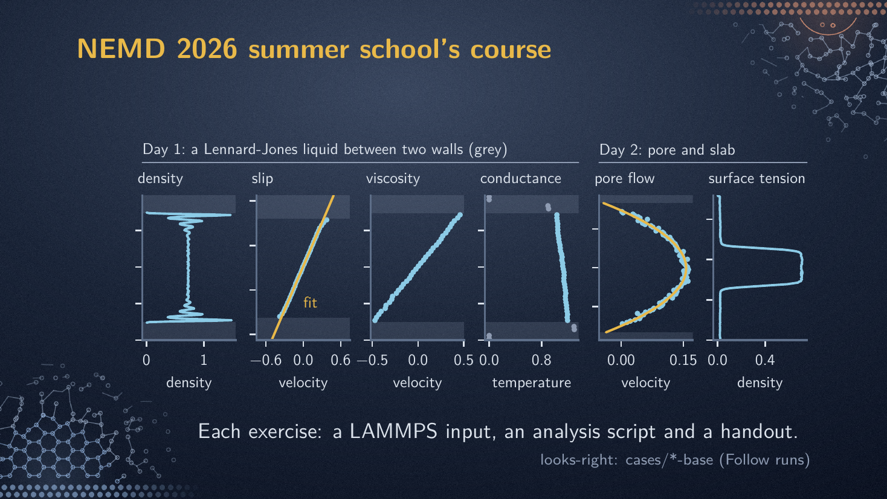
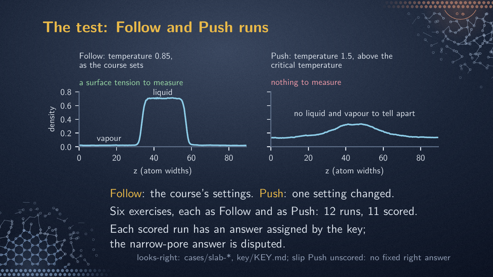
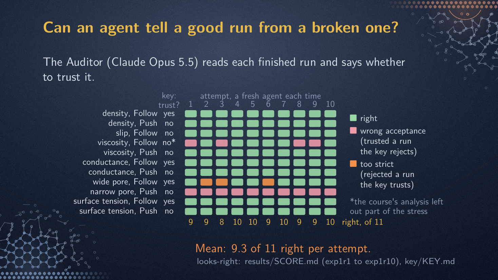
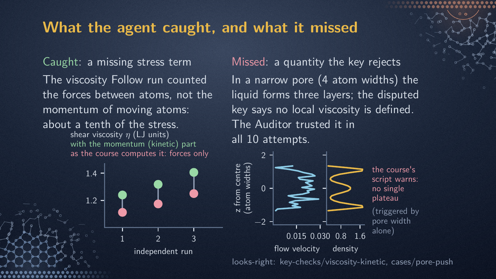

# Looks Right: an open test of AI agents' scientific judgement in atomistic simulation

This repository tests whether an AI agent can tell a trustworthy simulation result from one that looks right and is not. Before a simulation's
number is used, a scientist must judge it: did the run go on long enough, is the number the quantity it is reported
to be. AI agents are starting to make that judgement, and the people overseeing them need to know where it
fails. The test has 12 finished molecular dynamics runs (computer simulations of atoms moving in a
liquid) from a summer-school course, an AI agent asked to judge each
one, and an answer key. The repository holds the runs, the agent's exact instructions, every answer, the key, the scores and the scoring
code. Polywater, its first suite of runs, is named after the 1960s water result that looked right until it proved
to be ordinary water with impurities.

One experiment is released, Exp 1: Claude Opus 5.5 as the judge (the Auditor), in ten attempts, each over all 12 runs. The answer key fixes an answer for 11 of
the 12 runs (one is left open). The Auditor agreed with the key on 9.3 of the 11 per attempt on average, against 4 for accepting every run,
which is right only on the 4 runs the key trusts. It found an error in an input file the author wrote for the course. In all 10 attempts it trusted the
narrow-pore run (a channel only four atom widths across), which the key rejects (a disputed call, finding 3). Its answers
on two runs changed from one attempt to the next, with the same instructions and files (finding 4). The course's analysis scripts print warnings on some of the broken runs, so part of the Auditor's margin over
accepting every run may come from reading those warnings.

Version 0.2.1, 31 October 2026. Repository: https://github.com/RohitWPillai/looks-right.

## The test

**The runs.** Molecular dynamics (MD) follows every atom in a small box of matter, step by step, under the forces
between atoms. A run is one finished MD simulation: its input, its log and the result the course's analysis
script computed from it. The 12 runs come from the hands-on course of the NEMD 2026 summer school
([course repository](https://github.com/Non-Equilibrium-Molecular-Dynamics/NEMD-Summer-School-2026)), where
students work through six exercises, each measuring one property of a Lennard-Jones liquid, the textbook model
liquid. The author chaired the school's organising committee and wrote its Day 1 materials, including the viscosity
input. Each exercise was run twice: with the course's settings (the **Follow run**) and with one setting deliberately changed to challenge it (the
**Push run**). The Auditor saw each input with the course's comments that give the answer away removed. The six
exercises measure the density profile, slip length, shear viscosity (resistance to flow), thermal conductance, pore flow and surface
tension; their Push
runs change, respectively, the averaging width, the wall attraction, the wall speed, the settling-in period, the pore
width (from 10 atom widths, the **wide pore**, to 4, the **narrow pore**) and the temperature. Settings and definitions are in
[cases/README.md](cases/README.md).

**The Auditor.** The Auditor is one AI agent given one finished run and one sentence saying what the run is for, and
asked whether the result can be trusted for that purpose. It can read the run's files and nothing else. One call on
one run is a **look**. At its first look it answers trusted, untrusted or unresolved, with one sentence of cause and
its evidence, and may ask for one extra simulation with specified settings changed (the **named run**). Plain code (a script, no AI)
runs it; the Auditor then takes a second look at both runs and gives its final answer. An **attempt** (`try` in file and command names) is one pass over the
12 runs, with a blank memory for each look. The Auditor here is Claude Opus 5.5 under the Claude Code program; its
instructions are in `auditor/exp1-frozen/`, unchanged (SHA-256 fingerprints in `auditor/SHA256SUMS`); Exp 1 is ten attempts.

**The key and the score.** The answer key (the key) sets the author's required final answers for 11 of the 12 runs
(`key/KEY.md`, with the per-run rules); the Auditor never sees it. The exception is slip Push, whose stronger
wall attraction reduces how much the liquid slips, a real change in the physics rather than a fault, so it has no
fixed right answer; the Auditor still judges it on every attempt and its answers are released, but unscored. The key
trusts four of the 11, the density, conductance, wide-pore and surface-tension Follow runs, and rejects seven: the
five scored Push runs and two Follow runs, slip, whose course run is too short for the slip length to settle, and viscosity (finding 2). An
attempt's score is its number of right answers on those 11. "Right" means agreement with this key; it does not show that the
explanation was correct. The baseline, **accept everything**, trusts every run unread and is right on those four, 4 of 11.

**What counts as right.** Rejecting a run the key trusts is **too strict**; trusting a run the key rejects is a **wrong acceptance**;
on the density, viscosity and conductance Push runs the Auditor must name a repaired run, checked by plain code, and
trust it, so rejecting without one is a **missed fix**. In the narrow pore the liquid stacks into three layers, and the key holds that a single
viscosity cannot be defined there (disputed, finding 3); an answer counts as right only if it rejects that run for
this reason.

**When the key was set.** The key was first fixed before any agent saw the runs: every Follow run trusted, every
Push run with a fixed answer untrusted. It changed three times afterwards (`key/HISTORY.md`): the slip Follow
run became untrusted before Exp 1 ran; the narrow pore's reason requirement was added during Exp 1 and changes no
score; the viscosity Follow run became untrusted after Exp 1's answers had been read and the Auditor's objection
checked (finding 2). Under the key before that last change Exp 1 scores 9.1 and accept everything 5
(`results/SUMMARY.md`). Without the disputed narrow-pore run (finding 3) the score is 9.3 of 10.

## Findings

1. **The Auditor was right on 9.3 of 11 per attempt**; the attempts scored 9, 9, 8, 10, 10, 9, 10, 9, 9, 10
   (`results/SUMMARY.md`). Its misses: the viscosity Follow run (wrong acceptance in
   4 of 10 attempts), the wide-pore Follow run (too strict in 3 of 10) and the narrow-pore Push run (wrong
   acceptance in 10 of 10).
2. **The Auditor found an error in the author's course input, and so in the answer key.** The viscosity input counts
   the forces between atoms (the pair part of the stress) and leaves out the momentum the moving atoms carry (the
   kinetic part). The Auditor named the missing part in 6 of 10 attempts, the six whose final answer rejected the run. A
   plain-code check on three independent runs (`key-checks/viscosity-kinetic/`) found the kinetic part to be 11.6%, 12.4% and
   12.5% of the pair part, with the same sign, so the course's viscosity is too low. Scores under the original key
   are kept (`results/SCORE-original-key.md`).
3. **On the narrow pore, the Auditor trusted the run in all 10 attempts.** Every
   first look rejected the run, blamed noise, and asked for a stronger push on the liquid and, in 9 attempts, a longer run; every
   second look then trusted that named run and gave the layering as the reason there is no plateau (no flat middle region in the viscosity measured at each height across the pore). One attempt
   gave a reason close to the key's, that no local Newtonian viscosity exists across the pore, and trusted the run in
   the same answer. The key's reason is the author's physics judgement and is disputed (`key/NARROW-PORE.md`).
4. **Ten independent attempts did not always agree.** Every attempt had the same instructions and the same files,
   and every look started with a blank memory, yet the scores ranged from 8 to 10 of 11. On 9 of the 11 scored runs
   all ten final answers were the same; on two they split: the viscosity Follow run (6 right, 4 wrong acceptances)
   and the wide-pore Follow run (7 right, 3 too strict) (`results/right-per-case.csv`). The narrow-pore miss was
   unanimous, so agreement between attempts did not show that an answer was right. A person who reads the
   Auditor's answer from a single attempt sees one draw from this spread.

## The four slides

Four slides from the author's talk, redrawn from this repository's data and explained, with every number's source,
in [results/README.md](results/README.md#the-four-slides).






## Hints in the runs, and limitations

The course's analysis script prints a warning on several Push runs: "SLAB EVAPORATED" on the hot slab (the
surface-tension Push run), "imbalance
53.3%" and "the run is not steady; lengthen nequil (~40000)" on the conductance run, where nequil is the settling-in period (every attempt then asked for
a longer one; nine named 40000), "no layering left" on the density run, and on the narrow pore "a local Newtonian viscosity no longer
describes the liquid", printed for any pore narrower than a set width, whatever the data show (`cases/*/analysis.out`).
On the narrow pore all ten second looks refer to that warning (`key/NARROW-PORE.md`). The hint-removing step also
damaged a comment in both pore inputs (`results/README.md`, slide 4).

The numbers are small: 11 scored runs, 10 attempts, one model, one domain (one course's Lennard-Jones liquids). These are textbook faults, and a model may recognise them from its training rather than reason about the
run; a score cannot tell the two apart. This repository does not measure how scientists do on the same runs, or whether an
agent's answer helps them. The key can be wrong: one answer was corrected (finding 2); one is disputed (finding 3) and the
score is reported with and without it.

## How to check or rerun it

`REPRODUCE.md` gives the software versions, what each folder holds, and three levels of commands: regenerate every
score table from the shipped answers (free, seconds); rerun one run with the MD program LAMMPS (CPU only); run one
new Auditor attempt (paid; the ten attempts cost $42.54 at list price, about $4.25 an attempt). The free check:

```
python3 tools/check.py
python3 -m pytest tests
```

## Licence and citation

Own code (`tools/`, `tests/`, the scripts in `key-checks/`): MIT (`LICENSE`). Own data, text and figures: CC BY 4.0
(`LICENSE-data`). The course's files (listed in `COURSE-FILES.md`): used with permission under the course
repository's licence (MIT for code and inputs, `LICENSE-course`; CC BY 4.0 for handouts, figures and text), with
attribution to the NEMD Summer School 2026 organisers and contributors,
https://github.com/Non-Equilibrium-Molecular-Dynamics/NEMD-Summer-School-2026.

To cite: Rohit Pillai, Looks Right: an open test of AI agents' scientific judgement in atomistic simulation, version 0.2.1 (2026), https://github.com/RohitWPillai/looks-right
(`CITATION.cff`). Contact: Rohit Pillai, University of Edinburgh, https://rohitwpillai.github.io.
